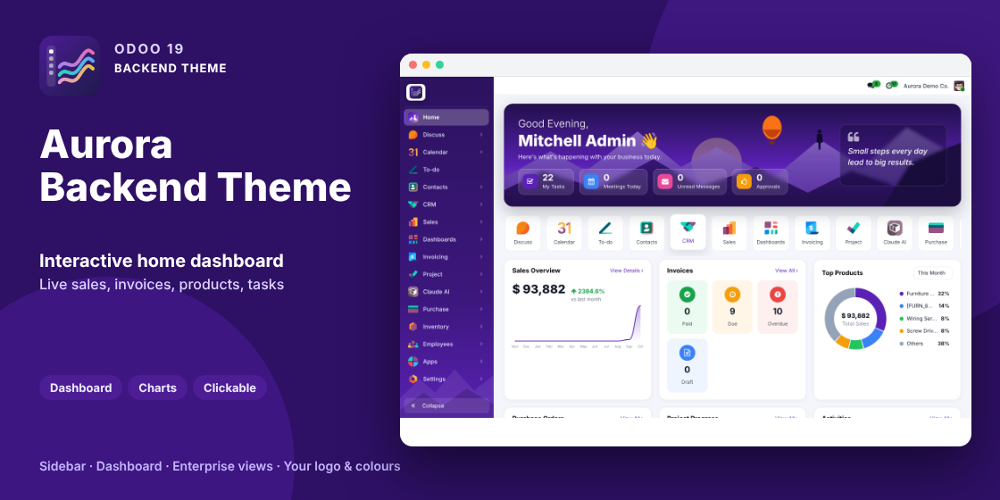

# Aurora Backend Theme | Modern Sidebar, Home Dashboard & Enterprise Views (Odoo 19)

A modern, professional backend theme for Odoo 19 Community and Enterprise: all menus in a collapsible sidebar, an interactive home dashboard, your company logo and colours, and enterprise-grade list, kanban and pivot views.

## Features
- **Sidebar navigation** - every app with its icon; expand an app to browse its menus and sub-menus (accordion). The default top-bar app switcher, app name and child menus are hidden on desktop. Collapse to icons (remembered per browser) with hover flyout menus; icon-only on tablets; standard menu kept on phones.
- **Company branding** - company logo in the sidebar; theme colours follow Settings > Companies > Document Layout colours, or are detected from the logo.
- **Interactive home dashboard** (home page for internal users, scrolls on its own) - greeting and live KPIs, sales overview, invoices, top products, purchases, revenue vs expenses, projects and tasks, activities, recent orders. Hover for details, click to open the matching records.
- **List view** - sticky uppercase headers, alternating rows, highlighted selection, group and total rows, aligned numbers, pill badges.
- **Kanban view** - column panels with accent bar, refined cards with hover lift.
- **Pivot view** - sticky headers, hover highlight, bold totals, tabular numbers.
- **Everything else** - form, graph, settings, dialogs, dropdowns and thin modern scrollbars.

## Installation
1. Copy `aurora_backend_theme` to your addons path and restart Odoo.
2. Apps > Update Apps List > install **Aurora Backend Theme**.
3. Hard-refresh the browser (Ctrl+Shift+R).

## Notes
- Depends on `web` and `mail`. Sales, Invoicing, Purchase, Project and Calendar dashboard blocks appear automatically when those apps are installed; figures respect access rights and record rules.
- On install, internal users without a home action get the dashboard; uninstall restores it.
- Users whose timezone is an old alias that PostgreSQL does not know (for example `Asia/Calcutta`) are switched to the canonical name (`Asia/Kolkata`) so core grouped views work.

## Support
raj.odoo2026@gmail.com

## Changelog
### 19.0.1.2.0
- Child menus only in the sidebar; top-bar Home/app name and menus hidden on desktop.
- Sidebar keeps the current app highlighted when an action opens without a menu (no more "Home" on pivot/kanban).
- Home page scroll bar.
- Enterprise look for list, kanban and pivot views.
- New logo, banner.gif, screenshots and store page.
### 19.0.1.1.0
- Expandable sub-menus, collapsed flyouts, company logo and colours, scrollbars, view restyling.
### 19.0.1.0.0
- Initial release: sidebar, top bar, home dashboard.
